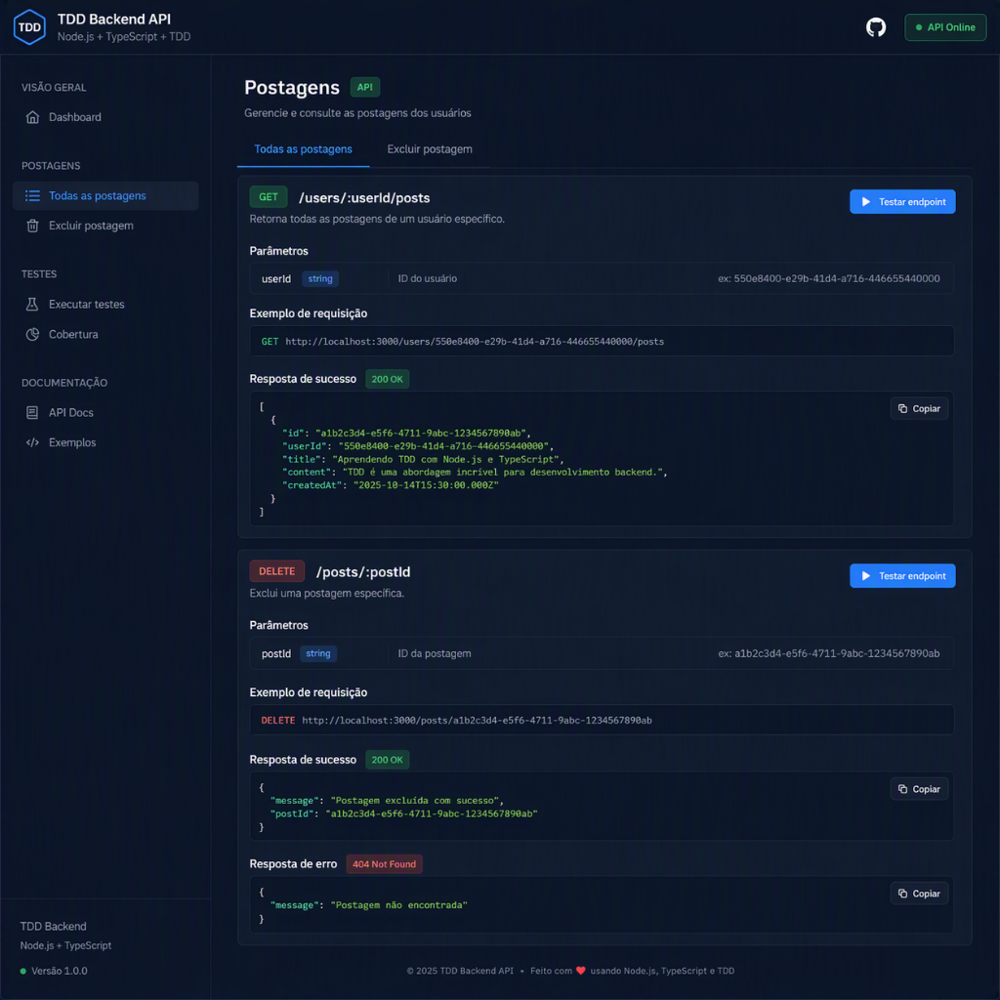

# TDD: Understanding and Practicing in a Node.js and TypeScript Backend

This project started during the Quality Assurance (QA) Experience Bootcamp under the guidance of [Nathally Souza](https://github.com/nathsouzadev "Nathally Souza").

The goal was to learn and practice Test-Driven Development (TDD) concepts in a Node.js and TypeScript backend application.

After completing the backend challenge, I decided to expand the project by creating a documentation interface focused on improving my frontend skills with HTML5, CSS3, and JavaScript, while applying semantic markup, accessibility practices, and responsive design principles.

## Backend Challenge

The following requirements were implemented using TDD:

- Retrieve all posts from a specific user
- Delete a specific post
- Unit tests covering business rules
- TypeScript support
- Node.js backend architecture

## Frontend Documentation Dashboard

The project also includes a lightweight API documentation dashboard designed for:

- Desktop
- Tablet
- Mobile devices

### Features

- Semantic HTML5 structure
- Accessibility-friendly implementation
- Fully responsive layout
- Dark mode as default theme
- Light mode support
- Moon/Sun theme switcher
- Internationalization (i18n)
  - English (default)
  - Portuguese (Brazil)
  - Spanish
- Interactive navigation tabs
- Copy-to-clipboard functionality
- API endpoint examples
- Modern UI inspired by professional API documentation tools

## Technologies

### Backend

- Node.js
- TypeScript
- Jest
- TDD

### Frontend

- HTML5
- CSS3
- JavaScript (Vanilla JS)
- Font Awesome
- Google Fonts (Inter)

## Accessibility Considerations

This project follows accessibility best practices, including:

- Semantic HTML landmarks
- ARIA labels where appropriate
- Keyboard-friendly navigation
- Sufficient visual hierarchy
- Responsive typography
- Screen-reader support

## Internationalization

English is the default language.

Supported languages:

| Language | Code |
|-----------|--------|
| English | EN-US |
| Portuguese (Brazil) | PT-BR |
| Spanish | ES |

Language switching occurs instantly without requiring a page reload.

## Theme Support

The application starts in Dark Mode by default.

Users can switch between:

- Dark Theme 🌙
- Light Theme ☀️

using the theme toggle button located in the header.

## Preview

## Author

Developed by Nivaldo Beirão.

Inspired by the DIO QA Experience Bootcamp and enhanced as a personal study project focused on TDD, accessibility, responsiveness, and frontend fundamentals.

[LICENSE](./LICENSE)
